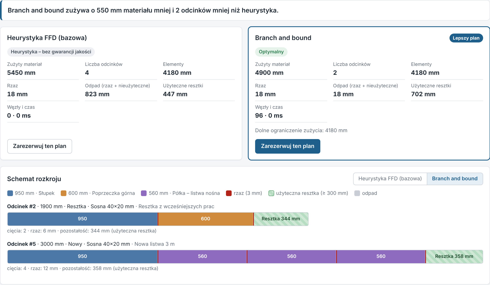
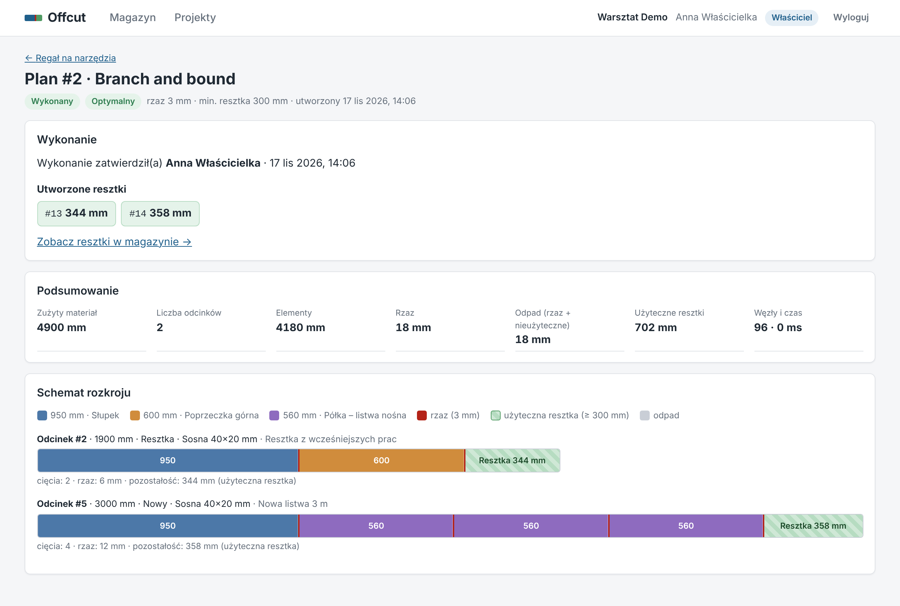

# Offcut — optymalizacja cięcia materiałów i wykorzystania resztek

Aplikacja webowa dla majsterkowiczów i małych warsztatów. Na podstawie fizycznych odcinków w magazynie
(nowych listew i resztek z wcześniejszych prac) oraz zapotrzebowania (długość × liczba sztuk) wylicza
plan cięcia z uwzględnieniem **szerokości rzazu**, porównuje **heurystykę zachłanną** z dokładniejszym
**branch and bound**, pokazuje plan jako schemat, a po zatwierdzeniu wykonania aktualizuje magazyn
i zapisuje użyteczne resztki.

Projekt indywidualny z przedmiotu ZTPAI (Politechnika Krakowska, zima 2026/27).

## Funkcjonalności

* logowanie (cookie HttpOnly + CSRF), role **właściciel** i **operator** warsztatu, izolacja warsztatów,
* ewidencja odcinków i resztek – każdy fizyczny odcinek ma własne ID i historię (pochodzenie resztki),
* specyfikacje materiałów (materiał + przekrój) i zgodność materiałowa przy planowaniu,
* projekty cięcia: zapotrzebowanie (specyfikacja, długość, liczba sztuk; dodawanie, edycja, usuwanie),
  rzaz, próg użytecznej resztki,
* **optymalizacja rozkroju 1D**: FFD vs branch and bound na tych samych danych, statusy wyniku,
  limity obliczeń, raport braku materiału,
* graficzny schemat cięcia (elementy, rzaz, resztka/odpad) i porównanie metod,
* instrukcja cięcia krok po kroku do druku (pozycje linii cięcia, co zrobić z pozostałością),
* rezerwacja materiału z ochroną przed podwójną rezerwacją (blokady w PostgreSQL),
* zatwierdzanie wykonania – idempotentne, atomowe zużycie odcinków i zapis resztek do magazynu,
* unieważnianie planów po zmianie zapotrzebowania lub parametrów,
* plan ręczny przez API (ten sam walidator bilansu co algorytmy).

## Stack

| Warstwa | Technologie |
|---|---|
| Backend | Python 3.13, FastAPI, SQLAlchemy 2, Alembic, Pydantic 2, argon2-cffi, PyJWT |
| Baza | PostgreSQL 16 |
| Frontend | React 19, TypeScript, Vite, react-router |
| Testy | pytest (na PostgreSQL), Playwright (przepływ w przeglądarce) |
| Uruchomienie | Docker Compose (PostgreSQL + backend + nginx z frontendem) |

Zależności są zablokowane: `backend/uv.lock` (+ `backend/requirements.txt` z hashami dla obrazu Docker),
`frontend/package-lock.json`.

## Uruchomienie (Docker Compose)

Wymagania: Docker z Compose v2 (Docker Desktop na Windows/macOS) oraz Git.

**1. Pobranie projektu**

```bash
git clone https://github.com/wokapala/offcut.git
```

```bash
cd offcut
```

**2. Plik konfiguracyjny** (Linux/macOS; w PowerShell: `Copy-Item .env.example .env`)

```bash
cp .env.example .env
```

Wartości z `.env.example` wystarczą do lokalnego uruchomienia. Poza komputerem lokalnym zmień
`POSTGRES_PASSWORD` i `OFFCUT_SECRET_KEY` (np. wynik `python -c "import secrets; print(secrets.token_urlsafe(48))"`).

**3. Budowa i start** (baza, migracje, backend, frontend)

```bash
docker compose up --build -d
```

**4. Sprawdzenie, czy wszystko działa** (backend i baza powinny mieć stan `healthy`)

```bash
docker compose ps
```

**5. Dane demonstracyjne** (opcjonalne, bezpieczne do ponownego uruchomienia)

```bash
docker compose exec backend python -m app.seed
```

**6. Aplikacja:** http://localhost:8080 – logowanie `wlasciciel@offcut.demo` / `Demo1234!`.

Zatrzymanie (dane zostają w wolumenie):

```bash
docker compose down
```

| Usługa | Adres |
|---|---|
| aplikacja (frontend) | http://localhost:8080 |
| dokumentacja API (Swagger UI) | http://localhost:8080/api/docs |
| healthcheck API | http://localhost:8080/api/health |

Port zmienisz zmienną `OFFCUT_HTTP_PORT` w `.env`. Backend i baza nie są publikowane na hoście –
ruch do `/api` przechodzi przez nginx kontenera `frontend`.

### Migracje i dane demo

Migracje Alembic uruchamiają się automatycznie przy każdym starcie kontenera `backend`
(`alembic upgrade head`, od pustej bazy). Aplikacja startuje **bez** danych demo – własny warsztat
można zarejestrować przez API: `POST /api/auth/register` (np. w Swagger UI pod `/api/docs`).
Interfejs nie ma formularza rejestracji.

Dane demonstracyjne ładuje się jawnie jednym poleceniem (bezpieczne do ponownego uruchomienia –
nie duplikuje danych):

```bash
docker compose exec backend python -m app.seed
```

Pełny reset bazy (usuwa wolumen z danymi):

```bash
docker compose down -v
```

### Konta demonstracyjne (tylko lokalne dane demo)

Hasło dla wszystkich: `Demo1234!`

| E-mail | Rola | Warsztat |
|---|---|---|
| `wlasciciel@offcut.demo` | właściciel | Warsztat Demo |
| `operator@offcut.demo` | operator | Warsztat Demo |
| `obcy@offcut.demo` | właściciel | Stolarnia Obca (do pokazania izolacji) |

Dane demo zawierają:

| Projekt | Heurystyka FFD | Branch and bound |
|---|---|---|
| „Regał na narzędzia” (6 elementów, sosna) | 5450 mm, 4 odcinki | **4900 mm, 2 odcinki** |
| „Stojak na drewno kominkowe” (13 elementów, świerk) | 14 150 mm, 8 odcinków | **10 200 mm, 4 odcinki** |
| „Wsporniki z profilu” (aluminium) | 2200 mm, 1 odcinek | 2200 mm, 1 odcinek (remis) |
| „Listwy przypodłogowe (za mało materiału)” | brak planu | brak planu – raport braku materiału |

Wyniki są sprawdzane testem `backend/tests/test_seed.py`.
Scenariusz prezentacji: [`docs/DEMO.md`](docs/DEMO.md).

## Testy

Backend – testy działają na **prawdziwym PostgreSQL** (transakcje, blokady, ograniczenia), nie na SQLite:

```bash
docker compose -f docker-compose.test.yml up -d
```

Z katalogu głównego projektu:

```bash
cd backend && uv sync && uv run pytest
```

Baza testowa nasłuchuje na porcie 5433 (inny adres: `OFFCUT_TEST_DATABASE_URL`). Schemat jest
tworzony migracjami Alembic przy każdym uruchomieniu testów.

Zakres: model rzazu i bilans, walidator planu, obie metody (w tym porównanie B&B z pełnym przeglądem
na losowych instancjach), brak materiału, niezgodny materiał, limity, logowanie i CSRF, role,
izolacja warsztatów (także po bezpośrednim ID), pełny przepływ, konflikt i współbieżność rezerwacji,
ponowienie wykonania, wycofanie transakcji przy błędzie, ograniczenia bazy.

Przepływ w przeglądarce (Playwright): logowanie → projekt i zapotrzebowanie → optymalizacja
(5450 vs 4900 mm) → rezerwacja → wykonanie → resztki w magazynie. Test sam tworzy nowy warsztat przez
API, więc można go powtarzać. Wymaga działającej aplikacji (`docker compose up`):

Z katalogu głównego projektu (w nowym terminalu):

```bash
cd frontend && npm ci && npx playwright install chromium
```

```bash
npx playwright test
```

Inny adres aplikacji: `E2E_BASE_URL=http://localhost:5173 npx playwright test`.

### Frontend w trybie deweloperskim

Backend lokalnie na porcie 8000 (np. `uv run uvicorn app.main:app` z ustawionymi `OFFCUT_DATABASE_URL`
i `OFFCUT_SECRET_KEY`), potem `cd frontend && npm run dev` → http://localhost:5173 (Vite przekazuje
`/api` do backendu).

## Zrzuty ekranu

Porównanie metod i schemat rozkroju (projekt „Regał na narzędzia”):



Plan wykonany – resztki wracają do magazynu:



Pozostałe ekrany: [`docs/screenshots/`](docs/screenshots/).

## Funkcja zaawansowana: optymalizacja rozkroju 1D

* **Model rzazu**: cięcia między elementami, cięcie oddzielające resztkę, brak cięcia przy dokładnym
  wykorzystaniu końca odcinka; bilans `odcinek = elementy + rzaz + pozostałość` w całkowitych mm.
* **Funkcja celu**: (1) całe zapotrzebowanie, (2) minimalna łączna długość zużytych odcinków,
  (3) minimalna liczba odcinków.
* **Heurystyka bazowa**: first-fit decreasing.
* **Metoda dokładniejsza**: branch and bound startujące od wyniku FFD, z dolnym ograniczeniem
  pojemnościowym, usuwaniem symetrii i limitem węzłów/czasu.
* **Statusy**: `OPTIMAL` tylko po pełnym przeszukaniu; przy limicie `BEST_FOUND`
  („najlepszy znaleziony w limicie”); `INFEASIBLE` przy braku materiału.

Szczegóły, przykłady i ograniczenia: [`docs/ALGORITHM.md`](docs/ALGORITHM.md).

## Dokumentacja

| Dokument | Zawartość |
|---|---|
| [`docs/ALGORITHM.md`](docs/ALGORITHM.md) | model rzazu, funkcja celu, algorytmy, limity, statusy, przykład |
| [`docs/ERD.md`](docs/ERD.md) | diagram ERD i ograniczenia bazy |
| [`docs/API.md`](docs/API.md) + Swagger | kluczowe operacje, uprawnienia, błędy |
| [`docs/DEMO.md`](docs/DEMO.md) | scenariusz demonstracji 3–5 min |
| [`docs/DEFENSE_NOTES.md`](docs/DEFENSE_NOTES.md) | decyzje, reguły biznesowe, pytania |
| [`docs/prezentacja.pdf`](docs/prezentacja.pdf) | prezentacja projektu (16 slajdów; wersja offline: `docs/prezentacja.html`) |
| [`docs/IMPLEMENTATION_STATUS.md`](docs/IMPLEMENTATION_STATUS.md) | stan projektu, sposób weryfikacji, ograniczenia |

## Struktura

```
backend/
  app/domain/      model rzazu, walidator planu, FFD i branch and bound (czysty Python)
  app/services/    planowanie, rezerwacja, wykonanie (transakcje i blokady)
  app/api/         endpointy REST
  app/models.py    model relacyjny (SQLAlchemy)
  alembic/         migracje
  tests/           pytest (PostgreSQL)
frontend/          React + TypeScript (Vite), nginx w obrazie produkcyjnym
docs/              dokumentacja
```

## Ograniczenia

* Funkcja celu nie wycenia tworzonych resztek (opis i przykład w `ALGORITHM.md`).
* Duże instancje kończą się limitem obliczeń (`BEST_FOUND`); limit 200 elementów na projekt.
* Brak resetu hasła, zarządzania kontem i zaproszeń e-mail (członków dodaje właściciel przez API).
* Plan ręczny dostępny tylko przez API (bez edytora w UI).
* Optymalizacja działa synchronicznie w żądaniu HTTP.
