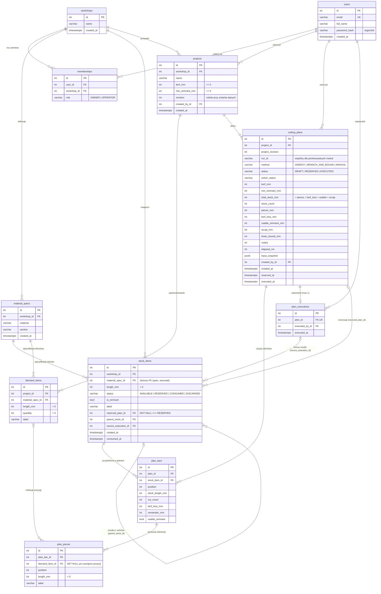

# Diagram ERD

Diagram odpowiada migracji `backend/alembic/versions/0001_initial_schema.py` (sprawdzony z
`information_schema` bazy po `alembic upgrade head`). GitHub renderuje blok Mermaid automatycznie.

## Najważniejsze ograniczenia

| Tabela | Ograniczenie | Cel |
|---|---|---|
| `memberships` | `UNIQUE(user_id, workshop_id)`, `CHECK role IN (...)` | jedno członkostwo, znane role |
| `material_specs` | `UNIQUE(workshop_id, material, section)`, `UNIQUE(id, workshop_id)` | brak duplikatów; cel złożonego FK |
| `stock_items` | FK `(material_spec_id, workshop_id)` → `material_specs(id, workshop_id)` | odcinek nie może mieć specyfikacji z innego warsztatu |
| `stock_items` | `CHECK length_mm > 0`, `CHECK status IN (...)` | dodatnie długości, dozwolone stany |
| `stock_items` | `CHECK (status = 'RESERVED') = (reserved_plan_id IS NOT NULL)` | rezerwacja zawsze wskazuje plan |
| `stock_items` | `CHECK source_execution_id IS NULL OR is_remnant` | odcinek z wykonania jest resztką |
| `stock_items` | indeks `(workshop_id, material_spec_id, status)` | wyszukiwanie kandydatów do optymalizacji |
| `projects` | `CHECK kerf_mm >= 0`, `CHECK min_remnant_mm >= 0` | nieujemny rzaz i próg |
| `demand_items` | `CHECK length_mm > 0`, `CHECK quantity > 0` | dodatnie długości i liczby sztuk |
| `cutting_plans` | `CHECK total_stock_mm = pieces_mm + kerf_loss_mm + usable_remnant_mm + scrap_mm` | bilans długości planu |
| `cutting_plans` | częściowy `UNIQUE(project_id) WHERE status IN ('RESERVED','EXECUTED')` | najwyżej jeden aktywny plan projektu |
| `plan_bars` | `UNIQUE(plan_id, stock_item_id)`, `UNIQUE(plan_id, position)` | odcinek raz w planie |
| `plan_executions` | `UNIQUE(plan_id)` | plan wykonany najwyżej raz |

`input_snapshot` (JSONB) przechowuje tylko kopię wejścia algorytmu (długości, kandydaci, limity) do
audytu – relacje planu są w tabelach `plan_bars` i `plan_pieces`.
